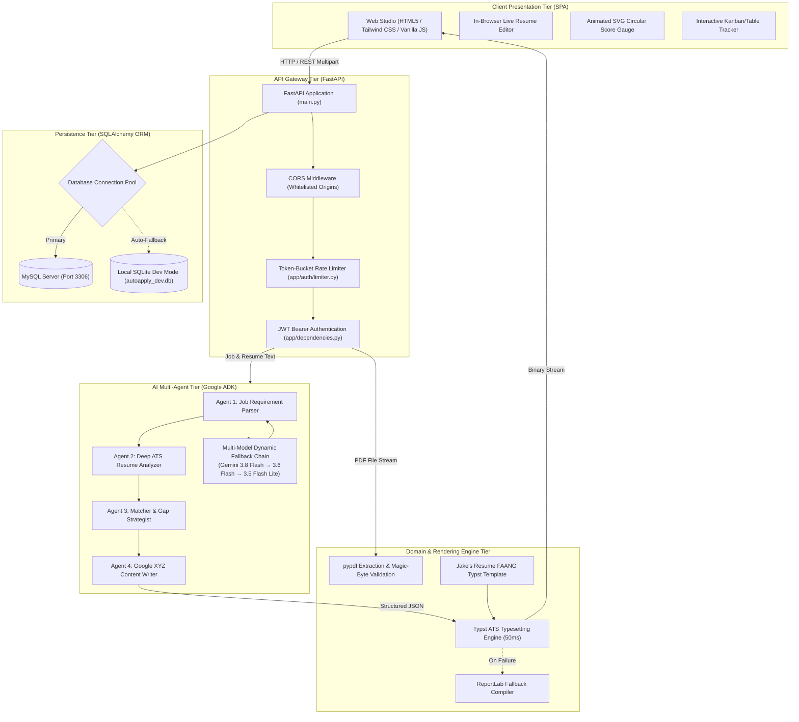
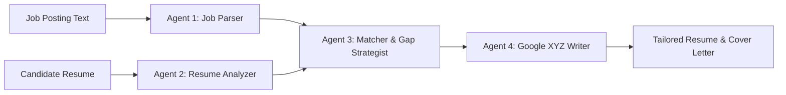

# AutoApply — Autonomous Multi-Agent AI Job Application Assistant

<div align="center">


**An enterprise-grade, agentic AI platform that analyzes job descriptions, parses candidate resumes, computes ATS match scores, generates quantified bullet points using Google's XYZ formula, compiles single-column ATS-compliant PDF resumes, and tracks application lifecycles.**

</div>

---

## 💡 Executive Summary & Problem Statement

### The Problem
In modern hiring pipelines, **over 75% of job applications are filtered out by automated Applicant Tracking Systems (ATS)** before reaching a human recruiter:
1. **Keyword Disconnect:** Resumes fail to reflect the vocabulary and core technical requirements of specific job descriptions.
2. **Formatting Fragility:** Complex two-column layouts, tables, text boxes, and non-standard fonts cause ATS parsers (Greenhouse, Lever, Workday) to scramble text or drop critical sections.
3. **Weak Impact Articulation:** Projects and responsibilities are written as passive duty lists rather than quantified achievements.
4. **Disorganized Tracking:** Job seekers manage submissions across disconnected spreadsheets with no unified record of customized assets.

### The AutoApply Solution
AutoApply replaces simplistic, single-prompt ChatGPT wrappers with an orchestrated **4-Agent Sequential Pipeline** built with the **Google Agent Development Kit (ADK)** and paired with a **50ms Typst typesetting engine**. It delivers:
* Deep semantic requirement extraction and skill gap analysis.
* Quantitative ATS compatibility scoring (0–100%).
* Bullet points re-engineered under **Google's XYZ Formula** (*"Accomplished [X] as measured by [Y] by doing [Z]"*).
* Single-column, 100% ATS-parsable PDF resume generation.
* End-to-end MySQL/SQLite application persistence with interactive status tracking.

---

## 🏛️ End-to-End System Architecture



---

## 🤖 The 4-Agent Pipeline Deep-Dive (Google ADK)

AutoApply executes four sequential AI agents. Each agent possesses dedicated system directives, strict prompt isolation delimiters, and validated JSON schemas:



### 1. Agent 1: Job Requirement Parser
* **Role:** Deconstructs unstructured job descriptions into structured taxonomy.
* **Outputs:** Job title, hiring organization, mandatory technical skills, soft skills, preferred tools, and core daily responsibilities.
* **Security:** Operates inside `<untrusted_job_posting>` isolation tags to neutralize prompt injection attacks.

### 2. Agent 2: Deep ATS Resume Analyzer
* **Role:** Analyzes the candidate's existing background without hallucinations.
* **Outputs:** Candidate contact details, chronological work history, education history, categorized technical proficiencies, and technical projects.

### 3. Agent 3: Compatibility Matcher & Strategic Gap Analyst
* **Role:** Computes mathematical compatibility and identifies profile deficiencies.
* **Outputs:** 
  * Quantitative Match Score (0–100%).
  * Categorized matching skills (strengths).
  * Explicit skill gaps (missing prerequisites).
  * Strategic application advice to maximize interview probability.

### 4. Agent 4: Executive Content Writer (Google XYZ Formula)
* **Role:** Synthesizes optimized application materials without falsifying candidate experience.
* **Outputs:**
  * High-impact bullet points rewritten using the **Google XYZ Formula**:
    $$\text{Accomplished } [X] \text{ as measured by } [Y] \text{ by doing } [Z]$$
  * 3-Tier Categorized Skills taxonomy (Languages, Frameworks/Tools, Platforms/Concepts).
  * Professional 3-paragraph tailored cover letter.

### Dynamic Multi-Model Fallback Engine
To prevent rate limits (`HTTP 429`) or server capacity spikes (`HTTP 503`) from disrupting users, `app/pipeline/service.py` executes an automated fallback chain:
1. **Primary Model:** `gemini-3.8-flash` (Maximum reasoning & speed)
2. **First Backup:** `gemini-3.6-flash` (High reliability)
3. **Second Backup:** `gemini-3.5-flash-lite` (Guaranteed throughput)

---

## ⚡ Typst ATS Resume Engine

Traditional tools rely on headless Chromium (Puppeteer/Playwright) which requires massive RAM (>500MB) and takes 3–5 seconds per PDF. AutoApply pairs **Typst** with a Jinja2 template engine:
* **Compilation Speed:** Sub-50 milliseconds.
* **Pure Text Layer:** High-fidelity UTF-8 text layer readable by Greenhouse, Lever, and Workday.
* **Layout Discipline:** Strictly single-column, zero nested HTML tables, standard section headers.
* **Zero-Fail Guarantee:** If Typst is not installed on the host system, the backend automatically switches to an internal **ReportLab** compiler.

---

## 🔒 Defensive Security Architecture

AutoApply implements defense-in-depth across the entire stack:

* **Binary Magic-Byte Inspection:** Validates incoming resume uploads for genuine `%PDF-` file headers to block executable spoofing (`.exe` renamed to `.pdf`).
* **Decompression Bomb Protection:** Hard clamps enforce a 5MB maximum upload size and a 20,000 character buffer cap.
* **Prompt Injection Isolation:** Untrusted user input is enclosed in strict XML boundary tags (`<untrusted_job_posting>`, `<untrusted_resume_content>`) accompanied by explicit ignore-instruction directives.
* **Cryptographic Authentication:** Passwords hashed with salted **Bcrypt** (12 work factor rounds); stateless **HS256 JWT tokens** with short-lived expiration (60 minutes) and token revocation.
* **Rate Limiting:** Token-bucket rate limiting restricts authentication endpoints (5 login attempts/min, 3 registrations/min) to prevent brute-force attacks.
* **Client-Side Sanitization:** All dynamic DOM insertions utilize `textContent` or `sanitizeHTML()` to eliminate Cross-Site Scripting (XSS).

---

## 🗄️ Database & Persistence Model

The persistence layer uses **SQLAlchemy ORM** with automatic driver failover:
* **Primary Database:** MySQL on `localhost:3306` (`autoapply` database).
* **Automatic SQLite Fallback:** If MySQL / XAMPP is offline or unconfigured, the application seamlessly initializes `sqlite:///./autoapply_dev.db` with zero configuration.

```
┌─────────────────┐       1:N       ┌──────────────────────┐       1:1       ┌──────────────────────────┐
│      users      │ ─────────────── │     applications     │ ─────────────── │   application_contents   │
├─────────────────┤                 ├──────────────────────┤                 ├──────────────────────────┤
│ id (PK)         │                 │ id (PK)              │                 │ id (PK)                  │
│ email (Unique)  │                 │ user_id (FK -> users)│                 │ application_id (FK)      │
│ hashed_password │                 │ job_title            │                 │ job_description          │
│ name            │                 │ company_name         │                 │ final_tailored_cv (JSON) │
│ created_at      │                 │ match_score          │                 │ cover_letter             │
└─────────────────┘                 │ status (Enum)        │                 │ interview_tips (JSON)    │
                                    │ applied_date         │                 └──────────────────────────┘
                                    └──────────────────────┘
```

---

## 🛠️ Technology Stack

| Domain | Technology | Selection Rationale |
|---|---|---|
| **Backend Framework** | **FastAPI** (Python 3.10+) | Asynchronous ASGI performance, automatic OpenAPI documentation, Pydantic type safety |
| **AI Orchestration** | **Google ADK** | Native multi-agent workflows, state management, structured JSON schema enforcement |
| **Foundation LLM** | **Google Gemini** | Industry-leading context windows, ultra-fast TTFT, native tool calling |
| **Typesetting Engine** | **Typst** | Modern 50ms native binary PDF compilation; pure ATS-compliant single-column layout |
| **PDF Extraction** | **pypdf** | Pure-Python stream extraction with zero external system binaries |
| **Database ORM** | **SQLAlchemy** | Clean separation of business logic and database engines; automated SQLite fallback |
| **Authentication** | **PyJWT + Passlib (Bcrypt)** | Stateless JWT authorization paired with industry-standard password salting |
| **Frontend Dashboard** | **HTML5, Tailwind CSS, Vanilla JS** | Lightweight, zero-node-dependency client with custom glassmorphism design tokens |
| **Test Suite** | **Pytest + Starlette TestClient** | Automated unit, security, integration, and rendering verification |

---

## 🚀 Quick Start Guide

### 1. Prerequisites
* **Python 3.10** or newer installed.
* A **Google Gemini API Key** (obtain free from [Google AI Studio](https://aistudio.google.com/)).
* *(Optional)* MySQL / XAMPP (the system runs on built-in SQLite if MySQL is absent).

### 2. Environment Setup

```bash
# Clone the repository
git clone https://github.com/talent00mahathir/AutoApply.git
cd autoapply

# Create and activate virtual environment
python -m venv .venv

# Windows (PowerShell):
.\.venv\Scripts\Activate.ps1

# Linux / macOS:
source .venv/bin/activate

# Install dependencies
pip install -r requirements.txt
```

### 3. Configure Credentials

Copy the template configuration file:
```bash
# Windows:
copy .env.example .env

# Linux / macOS:
cp .env.example .env
```

Open `.env` and configure your credentials:
```ini
GOOGLE_API_KEY=AIzaSy...your_gemini_api_key_here
JWT_SECRET_KEY=e8f9b2c3d4e5f6a7b8c9d0e1f2a3b4c5...your_random_64_char_key
DATABASE_URL=mysql+pymysql://root:@localhost:3306/autoapply?charset=utf8mb4
ENV=development
```

### 4. Launch the Application

```bash
python run.py
```
* **Web Dashboard:** `http://localhost:8000`
* **Interactive API Documentation:** `http://localhost:8000/docs`
* **Health Check:** `http://localhost:8000/api/health`

---

## 🧪 Automated Test Suite (24/24 Passing)

AutoApply includes a comprehensive `pytest` verification suite covering security, authentication, PDF parsing, and API gateway routing:

```bash
pytest -v
```

```
============================== test session starts ==============================
collected 24 items

tests/test_api_endpoints.py::test_health_check_endpoint              PASSED [  4%]
tests/test_api_endpoints.py::test_sample_data_endpoint               PASSED [  8%]
tests/test_api_endpoints.py::test_root_endpoint                      PASSED [ 12%]
tests/test_api_endpoints.py::test_sample_data_variants               PASSED [ 16%]
tests/test_api_endpoints.py::test_dashboard_stats_guest              PASSED [ 20%]
tests/test_api_endpoints.py::test_analyze_caps_payload_size          PASSED [ 25%]
tests/test_api_endpoints.py::test_analyze_rejects_empty_job          PASSED [ 29%]
tests/test_api_endpoints.py::test_security_headers_present           PASSED [ 33%]
tests/test_auth.py::test_password_hashing_and_verification           PASSED [ 37%]
tests/test_auth.py::test_jwt_token_creation_and_decoding             PASSED [ 41%]
tests/test_auth.py::test_jwt_invalid_token_rejected                  PASSED [ 45%]
tests/test_auth.py::test_jwt_expiration                              PASSED [ 50%]
tests/test_auth.py::test_weak_password_rejected                      PASSED [ 54%]
tests/test_auth.py::test_jwt_revocation_on_logout                    PASSED [ 58%]
tests/test_auth.py::test_rate_limiter_blocks_burst                   PASSED [ 62%]
tests/test_pdf_security.py::test_empty_pdf_raises_error              PASSED [ 66%]
tests/test_pdf_security.py::test_invalid_magic_bytes_rejected         PASSED [ 70%]
tests/test_pdf_security.py::test_oversized_file_rejected              PASSED [ 75%]
tests/test_pdf_security.py::test_valid_pdf_magic_bytes_detected      PASSED [ 79%]
tests/test_pdf_security.py::test_corrupted_pdf_structure_handled     PASSED [ 83%]
tests/test_resume_typst.py::test_escape_typst_special_characters      PASSED [ 87%]
tests/test_resume_typst.py::test_typst_resume_compilation            PASSED [ 91%]
tests/test_resume_typst.py::test_reportlab_fallback_compilation      PASSED [ 95%]
tests/test_resume_typst.py::test_master_generate_tailored_resume_pdf PASSED [100%]

======================== 24 passed in 9.03s ========================
```

---

## 📡 REST API Reference

| Endpoint | Method | Authentication | Description |
|---|---|---|---|
| `/api/health` | `GET` | Public | Returns service status and active primary Gemini model |
| `/api/analyze` | `POST` | Optional JWT | Runs the 4-agent ADK pipeline against job text and resume |
| `/api/resume/export-pdf` | `POST` | Optional JWT | Compiles tailored JSON data into an ATS-compliant PDF resume |
| `/api/applications` | `GET` | Optional JWT | Lists tracked applications (user-specific or guest session) |
| `/api/applications` | `POST` | Optional JWT | Persists a new tailored application and its generated content |
| `/api/applications/{id}` | `GET` | Optional JWT | Retrieves full application details including saved cover letter |
| `/api/applications/{id}/status` | `PATCH` | Optional JWT | Updates application lifecycle status (`Applied`, `Interview`, etc.) |
| `/api/applications/{id}` | `DELETE`| Optional JWT | Cascades deletion of application record and associated content |
| `/api/auth/register` | `POST` | Public (Rate-limited)| Registers a new user account with salted password hashing |
| `/api/auth/login` | `POST` | Public (Rate-limited)| Authenticates credentials and issues short-lived JWT token |
| `/api/auth/me` | `GET` | Bearer JWT | Returns current authenticated profile information |
| `/api/dashboard/stats` | `GET` | Optional JWT | Computes user application statistics, average scores, and trends |

---

## 📁 Repository Structure

```text
autoapply/
├── main.py                     # FastAPI application entrypoint, CORS & middleware
├── run.py                      # Pre-flight environment check & browser launcher
├── AutoApply.bat               # 1-Click Windows Explorer desktop launcher
├── requirements.txt            # Pinned production Python dependencies
├── pytest.ini                  # Pytest runner configuration
├── .env.example                # Sanitized environment template
├── .gitignore                  # Git exclusions (protects secrets, venvs & caches)
├── README.md                   # Comprehensive project documentation
│
├── app/                        # Application source code
│   ├── dependencies.py         # Route dependencies (JWT auth & DB sessions)
│   ├── auth/                   # Authentication & security subsystem
│   │   ├── security.py         # Bcrypt password hashing & JWT encoding/decoding
│   │   ├── service.py          # User queries and authentication business logic
│   │   └── limiter.py          # Token-bucket rate limiter for auth endpoints
│   ├── database/               # Database persistence layer
│   │   ├── connection.py       # SQLAlchemy engine with MySQL-to-SQLite fallback
│   │   └── models.py           # User, Application, ApplicationContent ORM models
│   ├── pipeline/               # Multi-agent AI subsystem (Google ADK)
│   │   ├── agents.py           # 4-Agent definitions, prompts & prompt delimiters
│   │   └── service.py          # Pipeline runner with dynamic fallback chain
│   ├── routers/                # REST API routers
│   │   ├── analysis.py         # Multipart analysis & ADK pipeline trigger
│   │   ├── applications.py     # Application tracker CRUD endpoints
│   │   ├── auth.py             # User registration, login & profile endpoints
│   │   ├── dashboard.py        # Dashboard analytics & application statistics
│   │   └── resume.py           # Typst tailored resume PDF export endpoint
│   ├── schemas/                # Pydantic validation contracts
│   │   ├── analysis.py         # Analysis request and response data models
│   │   ├── applications.py     # Application tracker CRUD data models
│   │   └── auth.py             # Authentication payload data models
│   └── services/               # Core rendering & export domain services
│       ├── pdf_service.py      # Magic-byte check, Typst compiler & ReportLab failover
│       └── templates/          # ATS resume templates
│           └── resume_faang.typ.j2  # FAANG single-column Typst template
│
├── static/                     # Frontend Single Page Application (SPA)
│   ├── index.html              # Responsive dashboard shell & layout
│   ├── favicon.svg             # Application brand icon
│   ├── css/                    # Custom stylesheets & design tokens
│   │   └── app.css             # Glassmorphism panels, dark mode & animations
│   └── js/                     # Modular frontend architecture
│       ├── app.js              # Application bootstrapper
│       ├── router.js           # Hash-based SPA client router (#/tracker, etc.)
│       ├── auth.js             # Client JWT token management & session state
│       ├── api.js              # REST API client wrapper with error handling
│       ├── components.js       # Toast notifications, modal drawers & UI widgets
│       ├── utils.js            # XSS sanitation helpers & date formatters
│       └── pages/              # Individual page controllers
│           ├── landing.js      # Public landing page controller
│           ├── dashboard.js    # Metric cards & statistics controller
│           ├── analysis.js     # Live 4-agent studio & in-browser editor
│           ├── tracker.js      # Application table, search & status controller
│           ├── account.js      # User profile & account management
│           └── settings.js     # User preferences & API health diagnostics
│
├── tests/                      # Automated pytest verification suite
│   ├── test_api_endpoints.py   # Gateway routing, payload caps & health tests
│   ├── test_auth.py            # Bcrypt hashing, JWT issuance & rate limit tests
│   ├── test_pdf_security.py    # Binary magic-byte spoofing & size clamp tests
│   └── test_resume_typst.py    # Typst compilation & ReportLab failover tests
│
├── docs/                       # Academic defense & system blueprints
│   ├── PROJECT_BLUEPRINT.md    # Complete architectural specification & defense guide
│   ├── PROJECT_MILESTONES.md   # Implementation roadmap & verification milestones
│   └── AutoApply_Project_Proposal_Report.md # Formal university proposal report
│
└── scripts/                    # Maintenance & utility scripts
    └── start_server.bat        # Legacy server launcher script
```

---

## 📄 License

Released under the **MIT License**. Copyright © 2026 AutoApply Team.
