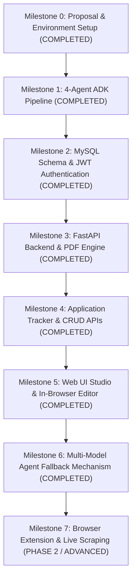

# AutoApply — Project Milestones & Implementation Roadmap

> **Project:** AutoApply: An Agentic AI Assistant for Job and Internship Applications  
> **Course:** CSE 3208: Software Development Project I (BUP)  
> **Stack:** FastAPI, MySQL, SQLAlchemy, Google ADK (Gemini), HTML/Tailwind CSS/JavaScript, ReportLab, pypdf  
> **Last Updated:** October 2026

---

## Executive Summary & Current Status

| Metric | Status |
|---|---|
| **Overall Progress** | **~95% Complete (All Core Milestones 0 to 6 Complete & Verified)** |
| **Current Operational State** | **Production-Ready Web Studio, Live In-Browser Editor, MySQL Tracker, 4-Agent Pipeline & Multi-Model Fallback** |
| **Next Immediate Objective** | **University Defense Presentation, Multi-Job Demo & Optional Phase 2 Browser Extension** |

---

## Codebase Inventory (Clean Architecture)

- **Entrypoints & Config:**
  - `main.py`: FastAPI application serving REST endpoints, static dashboard (`/`), CORS, and DB lifecycle.
  - `dependencies.py`: FastAPI route dependencies for JWT Bearer token authentication and DB sessions.
  - `.env`: Environment variables and Gemini API keys.
- **Frontend Dashboard:**
  - `static/index.html`: Responsive single-page web dashboard with raw text job pasting, file upload, live agent status animations, score badges, Google XYZ cards, in-browser live editor, 1-click PDF download, interactive status dropdown, and MySQL live tracking. Pure SVG icons (zero emoji stickers).
- **Test Datasets & Distinct Job Profiles:**
  - `mahathir_cv.md`: Candidate CV profile used as baseline.
  - `SAMPLE_JOB_1_DISTRIBUTED_NETWORKING.txt`: P2P, Dijkstra routing, swarm protocol systems job (highlights `PeerShare`).
  - `SAMPLE_JOB_2_DEVSECOPS_BACKEND.txt`: Defensive backend, Semgrep SAST, Pydantic, and Pytest QA job (highlights `Shopping Assistant`).
  - `SAMPLE_JOB_3_AGENTIC_AI_WORKFLOWS.txt`: Multi-agent graph workflows, Google ADK, and tool calling job (highlights `Ambient Expense Agent` & `Weather Assistant`).
  - `SAMPLE_JOB_POSTING.txt`: General Junior AI & Backend Software Engineer job.
- **AI Multi-Agent Pipeline (`pipeline/`):**
  - `pipeline/agents.py`: 4 Google ADK agents configured with `create_autoapply_pipeline(model_name)` and `MODEL_FALLBACK_CHAIN`.
    - **Agent 1:** Job Parser.
    - **Agent 2:** Deep ATS Resume Analyzer.
    - **Agent 3:** Compatibility Matcher & Gap Analyzer.
    - **Agent 4:** Executive Content Writer (Google XYZ Formula, 3-tier skills, cover letter).
  - `pipeline/service.py`: Sequential pipeline runner with dynamic multi-model failover loop (`gemini-3.8-flash` ➔ `gemini-3.6-flash` ➔ `gemini-3.5-flash-lite`), demand spike auto-retry, and JSON code-fence sanitization.
- **Database & Persistence (`database/`):**
  - `database/connection.py`: MySQL connection pooling (port 3306, `autoapply` database) and table provisioner.
  - `database/models.py`: SQLAlchemy ORM models (`User`, `Application`, `ApplicationContent`).
- **Authentication & Security (`auth/`):**
  - `auth/security.py`: Bcrypt password hashing (12 rounds) and JWT token generation/validation.
  - `auth/service.py`: Registration, authentication, and retrieval business logic.
- **Services (`services/`):**
  - `services/pdf_service.py`: PDF text extraction (`pypdf`) and ATS-compliant resume PDF compiler (`reportlab`).
- **REST Routers (`routers/`):**
  - `routers/auth.py`: `/api/auth/register`, `/api/auth/login`, `/api/auth/me`.
  - `routers/analysis.py`: `/api/analyze` (form-data/raw text + PDF/text CV) and `/api/sample-data`.
  - `routers/resume.py`: `/api/resume/export-pdf` (downloads compiled binary PDF).
  - `routers/applications.py`: `/api/applications` CRUD (save, list, detail, delete, and patch status).
- **Pydantic Schemas (`schemas/`):**
  - `schemas/auth.py`, `schemas/analysis.py`, `schemas/applications.py`.

---

## Detailed Milestone Status & Progress Log

### Milestone 0: Proposal & Environment Setup
- **Status:** `COMPLETED`
- [x] Project proposal report finalized (`AutoApply_Project_Proposal_Report.md`).
- [x] Python virtual environment configured (`venv`) with Google ADK, FastAPI, and SQLAlchemy.
- [x] `.env` configuration for Gemini API keys.

---

### Milestone 1: Multi-Agent AI Pipeline (Google ADK)
- **Status:** `COMPLETED & BENCHMARKED`
- [x] **Agent 1 (Job Parser):** Extracts core skills, responsibilities, tools, and nice-to-haves from unstructured text.
- [x] **Agent 2 (Resume Analyzer):** Profiles candidate education, contact information, project portfolio, and technical skills.
- [x] **Agent 3 (Matcher):** Calculates match score (0-100%), matching skills, gap analysis, and recommendations.
- [x] **Agent 4 (Google XYZ Writer):** Synthesizes bullet points under the Google XYZ formula (*"Accomplished [X] as measured by [Y] by doing [Z]"*), 3rd-person executive summary, and 3-paragraph cover letter.
- [x] **Resilience & Sanitization:** Added automatic backoff retries for transient demand spikes and markdown fence stripping.

---

### Milestone 2: MySQL Database Modeling & Authentication
- **Status:** `COMPLETED & FRESH SLATE`
- [x] Relational schema designed for `users`, `applications`, and `application_contents`.
- [x] Bcrypt password hashing and JWT token issuance.
- [x] Foreign key cascading and indexed queries for instant data retrieval.
- [x] Database cleaned of temporary testing rows; fresh slate ready for evaluation.
- [x] Password visibility toggle (eye icon) added to authentication forms.

---

### Milestone 3: Backend API & Resume Ingestion/Export Engine
- **Status:** `COMPLETED`
- [x] RESTful API endpoints for auth, analysis, and PDF export.
- [x] PDF ingestion using `pypdf` with fallback for plain text/markdown.
- [x] ATS-compliant resume PDF compilation using `ReportLab` (no GTK/cairo dependencies needed on Windows).
- [x] Endpoint `POST /api/resume/export-pdf` returns binary PDF with custom attachment headers.

---

### Milestone 4: Application Tracker & CRUD Endpoints
- **Status:** `COMPLETED`
- [x] `POST /api/applications`: Saves application record and linked `ApplicationContent` to MySQL.
- [x] `GET /api/applications`: Retrieves user's tracked applications.
- [x] `GET /api/applications/{id}`: Retrieves full application details and tailored CV data.
- [x] `PATCH /api/applications/{id}/status`: Live lifecycle status updates (`Applied` ➔ `Interview` ➔ `Offer` ➔ `Rejected`).
- [x] `DELETE /api/applications/{id}`: Deletes application and cascades deletion to content.

---

### Milestone 5: Web UI Studio & In-Browser Live Resume Editor
- **Status:** `COMPLETED`
- [x] Single-page responsive dashboard served at `GET /` (`static/index.html`).
- [x] Normal raw text copy-pasting for job descriptions (no JSON or curly braces needed).
- [x] Resume file upload (PDF/MD/TXT) or text toggle.
- [x] **In-Browser Live Resume Editor:**
  - Toggle between Preview Mode and Edit Mode.
  - Direct inline editing of Executive Summary, Categorized Skills, and Cover Letter.
  - Project-by-project Google XYZ bullet point textareas with "+ Add Bullet" and delete actions.
  - Edits automatically harvested when clicking "Download PDF" or "Save to MySQL".
- [x] **Interactive Status Dropdown:** Real-time `<select>` in the MySQL applications table triggers `PATCH /api/applications/{id}/status`.
- [x] **View Saved Application:** Click "View" on any tracked application to reload its full analysis into the studio.
- [x] **1-Click Direct PDF Download:** In-memory JSON dispatched to `/api/resume/export-pdf`.
- [x] **Pure SVG Icon System:** All informal emojis replaced with enterprise-grade inline SVG icons.

---

### Milestone 6: Multi-Model Agent Fallback Mechanism
- **Status:** `COMPLETED & VERIFIED`
- [x] **Dynamic Pipeline Instantiation:** Refactored `pipeline/agents.py` to generate clean `SequentialAgent` pipelines per model via `create_autoapply_pipeline(model_name)`.
- [x] **Configured Fallback Chain:**
  1. Primary: `gemini-3.8-flash`
  2. Backup 1: `gemini-3.6-flash`
  3. Backup 2: `gemini-3.5-flash-lite`
- [x] **Automatic Failover Loop:** Implemented in `pipeline/service.py` to catch 503 high-demand spikes, 429 quota exhaustion, or timeouts, discarding partial state and immediately failing over to the backup model.
- [x] **Live Verified:** Tested against `SAMPLE_JOB_1_DISTRIBUTED_NETWORKING.txt`. Successfully caught 503 spikes on 3.8 and 3.6, automatically pivoted to `gemini-3.5-flash-lite`, and delivered complete output in 82% match score with zero crash screens!
- [x] **Temporary Test Files Cleaned:** Deleted `test_temp_fallback.py` and reset MySQL applications count to 0.

---

### Milestone 7: Browser Extension & Live Scraping (Phase 2 / Future Scope)
- **Status:** `PHASE 2 / FUTURE SCOPE`
- [ ] Chrome/Edge Manifest V3 extension with active tab job description extraction.
- [ ] 1-click analysis button floating directly inside LinkedIn/Indeed job postings.
- [ ] Headless backend scraper fallback (`POST /api/scrape-and-analyze`).

---

## How to Resume in the Next Session

When starting the next session with the assistant, simply say:
> *"Let's continue AutoApply. Check `PROJECT_MILESTONES.md` — Milestones 0 through 6 are 100% complete. We are at **~95% progress**."*

### Current Working Context:
1. **Application Server:** Run `.\venv\Scripts\uvicorn main:app --reload` on `http://127.0.0.1:8000`.
2. **Dashboard URL:** Open `http://127.0.0.1:8000/` in Chrome or Edge.
3. **Database:** MySQL on port 3306 (XAMPP). Tables are clean (`applications` count: 0).
4. **Candidate Baseline:** `mahathir_cv.md` (active profile).
5. **3 Diverse Test Jobs Ready:**
   - `SAMPLE_JOB_1_DISTRIBUTED_NETWORKING.txt` (Distributed Systems)
   - `SAMPLE_JOB_2_DEVSECOPS_BACKEND.txt` (Security / DevSecOps)
   - `SAMPLE_JOB_3_AGENTIC_AI_WORKFLOWS.txt` (AI Agent Workflows)
