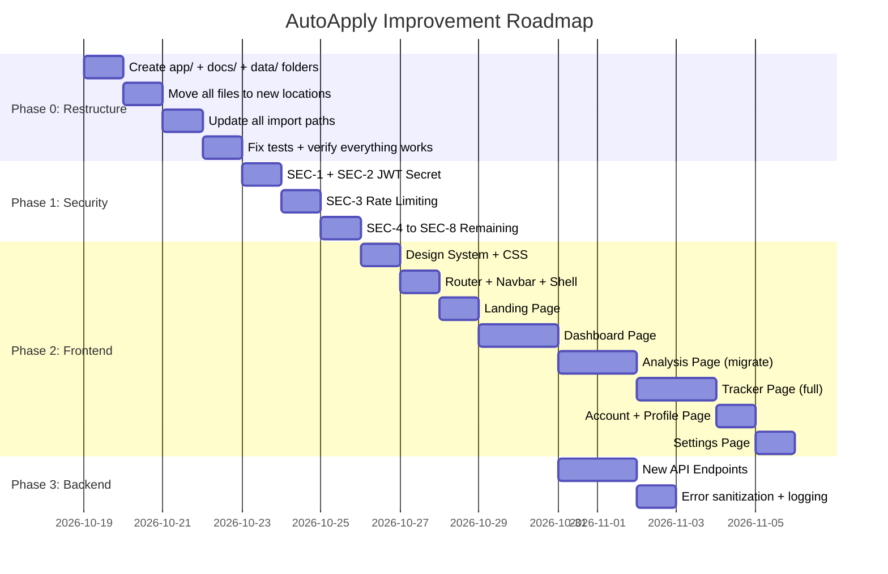

# AutoApply — Complete Improvement Plan

> **For:** Mohammad  
> **Date:** October 19, 2026  
> **Status:** 🎉 ALL PHASES COMPLETED (Phase 0: Restructure, Phase 1: Security, Phase 2: Frontend Redesign, Phase 3: Backend APIs). 18/18 Automated Tests Passing!

---

## Table of Contents
1. [Phase 0 — Project Structure Cleanup](#phase-0--project-structure-cleanup)
2. [Phase 1 — Security Hardening](#phase-1--security-hardening)
3. [Phase 2 — Complete Frontend Redesign](#phase-2--complete-frontend-redesign)
4. [Phase 3 — Backend API Additions](#phase-3--backend-api-additions)
5. [Implementation Roadmap](#implementation-roadmap)

---

## Phase 0 — Project Structure Cleanup

### The Problem Right Now

The project root is a mess — **21 files dumped at the top level** with no logical grouping:

```
autoapply/                          ❌ CURRENT (MESSY)
│
│── 24524203179_Mahathir_260826_211239.pdf   ← personal PDF sitting in root??
│── Mahathir_Mohammad_Tailored_Resume.pdf    ← generated output in root??
│── mahathir_cv.md                           ← personal CV in root??
│── SAMPLE_JOB_1_DISTRIBUTED_NETWORKING.txt  ← sample data cluttering root
│── SAMPLE_JOB_2_DEVSECOPS_BACKEND.txt      ← sample data cluttering root
│── SAMPLE_JOB_3_AGENTIC_AI_WORKFLOWS.txt   ← sample data cluttering root
│── SAMPLE_JOB_POSTING.txt                   ← sample data cluttering root
│── PROJECT_BLUEPRINT.md                     ← docs mixed with code
│── PROJECT_MILESTONES.md                    ← docs mixed with code
│── AutoApply_Project_Proposal_Report.md     ← docs mixed with code
│── README.md                                ← this one is fine
│── AutoApply.bat                            ← launcher mixed with code
│── start_server.bat                         ← launcher mixed with code
│── run.py                                   ← launcher mixed with code
│── main.py                                  ← app entry point (fine)
│── dependencies.py                          ← orphan file, no folder
│── requirements.txt                         ← fine
│── pytest.ini                               ← fine
│── .env / .env.example / .gitignore         ← fine
│
│── auth/                    ← 3 files (ok but has no __init__ for jwt)
│── database/                ← 3 files (ok)
│── pipeline/                ← 3 files (ok)
│── routers/                 ← 5 files (ok)
│── schemas/                 ← 4 files (ok)
│── services/                ← 2 files + templates/ (ok)
│── static/                  ← 1 giant file (index.html = 1540 lines)
│── tests/                   ← 4 files (ok)
│── venv/                    ← virtual env (ignored)
│── __pycache__/             ← cache (ignored)
```

**Problems:**
1. Personal PDFs and sample data files dumped directly in root
2. Documentation files mixed with source code at root level
3. Launcher scripts scattered at root
4. `dependencies.py` is an orphan — should be inside a module
5. `static/` has a single 1540-line monolith HTML file
6. No clear separation between "project config" and "source code"
7. Root has **21 files** — should have ~8-10 max

---

### The Clean Structure (After Restructure)

```
autoapply/                          ✅ CLEAN (AFTER)
│
│── main.py                          ← App entry point (stays)
│── run.py                           ← Python launcher (stays)
│── requirements.txt                 ← Dependencies (stays)
│── pytest.ini                       ← Test config (stays)
│── README.md                        ← Project readme (stays)
│── .env                             ← Secrets (stays, gitignored)
│── .env.example                     ← Template (stays)
│── .gitignore                       ← Git rules (stays, updated)
│── AutoApply.bat                    ← Windows launcher (stays)
│
│── app/                             ← ALL backend source code
│   │── __init__.py
│   │── dependencies.py              ← Moved from root
│   │
│   │── auth/                        ← Authentication module
│   │   │── __init__.py
│   │   │── security.py              ← Bcrypt + JWT
│   │   └── service.py               ← User queries
│   │
│   │── database/                    ← Database module
│   │   │── __init__.py
│   │   │── connection.py            ← Engine + session
│   │   └── models.py               ← ORM models
│   │
│   │── pipeline/                    ← AI agent pipeline
│   │   │── __init__.py
│   │   │── agents.py               ← Agent definitions
│   │   └── service.py              ← Pipeline runner
│   │
│   │── routers/                     ← API endpoints
│   │   │── __init__.py
│   │   │── auth.py
│   │   │── analysis.py
│   │   │── applications.py
│   │   └── resume.py
│   │
│   │── schemas/                     ← Pydantic models
│   │   │── __init__.py
│   │   │── auth.py
│   │   │── analysis.py
│   │   └── applications.py
│   │
│   └── services/                    ← Business logic
│       │── __init__.py
│       │── pdf_service.py
│       └── templates/
│           └── resume_faang.typ.j2
│
│── static/                          ← Frontend (restructured later in Phase 2)
│   └── index.html                   ← (Will be split in Phase 2)
│
│── tests/                           ← Test suite (stays)
│   │── test_api_endpoints.py
│   │── test_auth.py
│   │── test_pdf_security.py
│   └── test_resume_typst.py
│
│── data/                            ← Sample data & demo assets
│   │── samples/
│   │   │── SAMPLE_JOB_1_DISTRIBUTED_NETWORKING.txt
│   │   │── SAMPLE_JOB_2_DEVSECOPS_BACKEND.txt
│   │   │── SAMPLE_JOB_3_AGENTIC_AI_WORKFLOWS.txt
│   │   │── SAMPLE_JOB_POSTING.txt
│   │   └── mahathir_cv.md
│   └── output/                      ← Generated PDFs go here (gitignored)
│       └── .gitkeep
│
│── docs/                            ← All documentation
│   │── PROJECT_BLUEPRINT.md
│   │── PROJECT_MILESTONES.md
│   └── AutoApply_Project_Proposal_Report.md
│
└── scripts/                         ← Utility scripts
    └── start_server.bat             ← Legacy launcher
```

---

### File-by-File Move Instructions

| # | Action | From | To |
|---|--------|------|----|
| 1 | **Create** | — | `app/__init__.py` |
| 2 | **Move** | `dependencies.py` | `app/dependencies.py` |
| 3 | **Move** | `auth/` (entire folder) | `app/auth/` |
| 4 | **Move** | `database/` (entire folder) | `app/database/` |
| 5 | **Move** | `pipeline/` (entire folder) | `app/pipeline/` |
| 6 | **Move** | `routers/` (entire folder) | `app/routers/` |
| 7 | **Move** | `schemas/` (entire folder) | `app/schemas/` |
| 8 | **Move** | `services/` (entire folder) | `app/services/` |
| 9 | **Create** | — | `data/samples/` |
| 10 | **Move** | `SAMPLE_JOB_1_DISTRIBUTED_NETWORKING.txt` | `data/samples/` |
| 11 | **Move** | `SAMPLE_JOB_2_DEVSECOPS_BACKEND.txt` | `data/samples/` |
| 12 | **Move** | `SAMPLE_JOB_3_AGENTIC_AI_WORKFLOWS.txt` | `data/samples/` |
| 13 | **Move** | `SAMPLE_JOB_POSTING.txt` | `data/samples/` |
| 14 | **Move** | `mahathir_cv.md` | `data/samples/` |
| 15 | **Create** | — | `data/output/.gitkeep` |
| 16 | **Move** | `24524203179_Mahathir_260826_211239.pdf` | `data/output/` (or delete) |
| 17 | **Move** | `Mahathir_Mohammad_Tailored_Resume.pdf` | `data/output/` (or delete) |
| 18 | **Create** | — | `docs/` |
| 19 | **Move** | `PROJECT_BLUEPRINT.md` | `docs/` |
| 20 | **Move** | `PROJECT_MILESTONES.md` | `docs/` |
| 21 | **Move** | `AutoApply_Project_Proposal_Report.md` | `docs/` |
| 22 | **Create** | — | `scripts/` |
| 23 | **Move** | `start_server.bat` | `scripts/` |

### Import Path Updates Required

After moving everything into `app/`, all Python import paths must change:

| Old Import | New Import |
|------------|-----------|
| `from auth.security import ...` | `from app.auth.security import ...` |
| `from database.connection import ...` | `from app.database.connection import ...` |
| `from database.models import ...` | `from app.database.models import ...` |
| `from pipeline.agents import ...` | `from app.pipeline.agents import ...` |
| `from pipeline.service import ...` | `from app.pipeline.service import ...` |
| `from routers import ...` | `from app.routers import ...` |
| `from schemas.auth import ...` | `from app.schemas.auth import ...` |
| `from schemas.analysis import ...` | `from app.schemas.analysis import ...` |
| `from schemas.applications import ...` | `from app.schemas.applications import ...` |
| `from services.pdf_service import ...` | `from app.services.pdf_service import ...` |
| `from dependencies import ...` | `from app.dependencies import ...` |

**Files that need import updates:**
- `main.py` — 6 imports
- `app/dependencies.py` — 4 imports
- `app/routers/auth.py` — 4 imports
- `app/routers/analysis.py` — 5 imports
- `app/routers/applications.py` — 4 imports
- `app/routers/resume.py` — 2 imports
- `app/routers/__init__.py` — 4 imports
- `app/auth/__init__.py` — 2 imports
- `app/auth/service.py` — 2 imports
- `app/database/__init__.py` — 2 imports
- `app/pipeline/__init__.py` — 2 imports
- `app/pipeline/service.py` — 1 import
- `app/services/__init__.py` — 1 import
- `app/schemas/__init__.py` — 2 imports
- `tests/test_*.py` — all 4 test files

**Other path updates:**
- `routers/analysis.py` reads `SAMPLE_JOB_POSTING.txt` and `mahathir_cv.md` — paths change to `data/samples/...`
- `pytest.ini` — `pythonpath` needs to include project root
- `run.py` — `uvicorn.run("main:app")` stays the same since `main.py` stays at root

### `.gitignore` Additions

```gitignore
# Generated output
data/output/*.pdf

# Keep output directory structure
!data/output/.gitkeep
```

---

### Before vs After — Root File Count

| | Before | After |
|---|--------|-------|
| Files in root | **21** | **9** |
| Folders in root | 11 (including venv, __pycache__) | 7 |
| Personal files in root | 3 (PDFs + CV) | 0 |
| Sample data in root | 4 | 0 |
| Doc files in root | 3 | 0 (in `docs/`) |

**The root becomes clean and scannable at a glance.**

---

## Phase 1 — Security Hardening

> [!IMPORTANT]
> Quick wins done right after the restructure.

| ID | Fix | File | Effort |
|----|-----|------|--------|
| SEC-1 | Remove hard-coded JWT fallback — crash if `JWT_SECRET_KEY` not set | `app/auth/security.py` | 15 min |
| SEC-2 | Add `JWT_SECRET_KEY` to `.env` with a random 64-char token | `.env` | 5 min |
| SEC-3 | Add rate limiting on login (5/min) and register (3/min) | `main.py`, `app/routers/auth.py` | 1 hour |
| SEC-4 | Sanitize all `innerHTML` injections with `textContent`-based escaping | `static/js/*.js` | 2 hours |
| SEC-5 | Add `X-Requested-With` header check for state-changing requests | `main.py` | 30 min |
| SEC-6 | Strong passwords (8+ chars, uppercase, digit, symbol) | `app/auth/service.py` | 30 min |
| SEC-7 | Rate limit on PDF export endpoint | `app/routers/resume.py` | 30 min |
| SEC-8 | Restrict `allow_headers` to `["Content-Type", "Authorization"]` | `main.py` | 5 min |

---

## Phase 2 — Complete Frontend Redesign

### Navigation: GitHub-Style Top Navbar with Page Tabs

```
┌──────────────────────────────────────────────────────────────────────────┐
│ ⚡ AutoApply  │  Dashboard  │  New Analysis  │  Tracker  │     🔍  👤  │
│    v1.0 ADK   │             │                │           │   ☀️/🌙  ▼  │
└──────────────────────────────────────────────────────────────────────────┘
```

Active tab gets a bottom accent bar. Mobile gets a hamburger drawer.

### 6 Pages

| Page | Purpose | Key Components |
|------|---------|----------------|
| **Landing** (logged out) | Convince visitors to sign up | Hero banner, 3 feature cards, "How It Works" steps, tech badges, footer |
| **Dashboard** (home) | Overview at a glance | Welcome greeting, 4 stat cards, status bar chart, recent apps table, quick actions |
| **New Analysis** | Run the AI pipeline | Job input, resume upload/paste, pipeline stepper, results studio (score gauge, skills, XYZ bullets, cover letter, edit mode) |
| **Tracker** | Manage all applications | Search bar, filter dropdowns, sortable table, expandable rows, pagination, bulk delete |
| **Account & Profile** | User identity | Avatar with initials, editable name, account stats, change password, danger zone (delete account) |
| **Settings** | Preferences | Theme picker, default resume upload, AI model preference, system health info |

### New Frontend File Structure

```
static/
├── index.html              ← Shell: navbar, page containers, modals
├── css/
│   └── app.css             ← Design tokens, glassmorphism, animations
└── js/
    ├── router.js           ← Hash-based SPA routing (#/dashboard, etc.)
    ├── auth.js             ← Login, register, JWT helpers
    ├── landing.js          ← Landing page (logged-out)
    ├── dashboard.js        ← Dashboard stats + charts
    ├── analysis.js         ← Pipeline studio (migrated from current)
    ├── tracker.js          ← Full tracker with search/filter/sort
    ├── account.js          ← Profile, password change, stats
    ├── settings.js         ← Preferences, system info
    ├── components.js       ← Shared: navbar, toast, modals, skeletons
    └── utils.js            ← sanitizeHTML(), formatDate(), formatError()
```

---

## Phase 3 — Backend API Additions

| ID | New Endpoint / Fix | Effort |
|----|-------------------|--------|
| BE-1 | Fix duplicate DB engine creation in `connection.py` | 30 min |
| BE-2 | Sanitize pipeline error messages sent to client | 15 min |
| BE-3 | Add `X-Request-ID` middleware for log traceability | 1 hour |
| BE-4 | Validate application status against enum | 15 min |
| BE-5 | `GET /api/dashboard/stats` — total apps, avg score, status counts, recent apps | 1 hour |
| BE-6 | `PUT /api/auth/profile` — update name | 30 min |
| BE-7 | `PUT /api/auth/password` — change password | 1 hour |
| BE-8 | `DELETE /api/auth/account` — delete account + all data | 30 min |
| BE-9 | `GET /api/auth/stats` — account statistics | 30 min |
| BE-10 | `GET /api/sample-data/{type}` — serve different sample files per demo button | 30 min |

---

## Implementation Roadmap



### Estimated Effort

| Phase | Work | Time |
|-------|------|------|
| Phase 0 — Restructure | Move files, update imports, verify tests | ~3-4 hours |
| Phase 1 — Security | 8 security fixes | ~5-6 hours |
| Phase 2 — Frontend | 6-page SaaS redesign | ~15-20 hours |
| Phase 3 — Backend | New endpoints + fixes | ~5 hours |
| **Total** | | **~28-35 hours** |

### Execution Order

```
Phase 0 (Restructure)  →  Phase 1 (Security)  →  Phase 3 (Backend APIs)  →  Phase 2 (Frontend)
         ↓                       ↓                        ↓                        ↓
   Clean folders          Hardened auth           New endpoints ready       Beautiful SaaS UI
   Fixed imports          Rate limiting           Dashboard stats API       6 pages + navbar
   Tests pass             XSS prevention          Account management        Dark mode + glass
```

> [!NOTE]
> Phase 0 is done **first** because every later phase touches file paths. If we restructure after building new features, we'd have to update everything twice. Clean the house first, then renovate.

---

> Click **Proceed** when you're happy with this plan and I'll start executing Phase 0 (the restructure).
